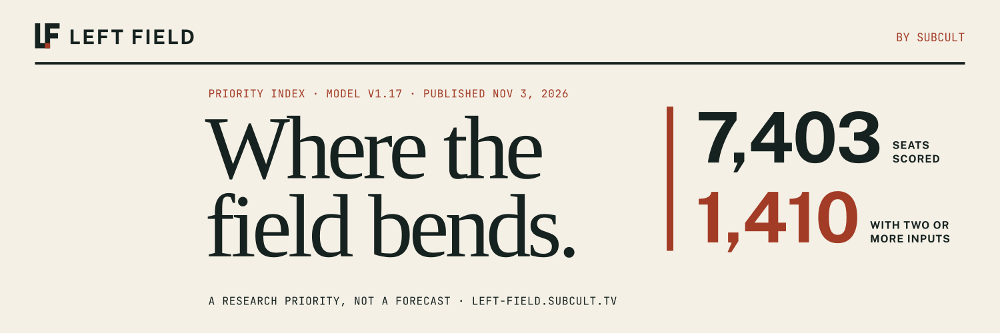

# Left Field



A score here is a research note with a version number. It is not a forecast or
an endorsement.

Left Field is a research site for seats in the U.S. House and Senate,
governorships and state legislatures. It puts seat-level public election,
geography and campaign-finance records beside their sources, scores each seat
with a provisional, versioned model, and says which inputs it does not have.
Missing information stays missing; it is never shown as a zero.

The site is in active development and published at
<https://left-field.subcult.tv/>. It works with public records at seat level
only. Individual voter files, inferred ideology and demographic targeting are
outside its scope, and nothing on the site implies a DSA endorsement.

## Features

- **Priority index** (`/priorities`): seats ranked by a provisional, versioned
  model, with component scores, evidence filters, publication and source dates,
  and coverage limits.
- **Seat pages** (`/seats/<id>`): factual House and Senate seat records with
  their sources.
- **Seat map** (`/map`): House districts, the Senate, governors and state
  legislatures on one map.
- **Release ledger** (`/browse`): the factual seat records in the active
  release.
- **Methodology** (`/methodology`): how the index model works, labeled with the
  model version and the factual release it reads.
- **Sources and coverage** (`/sources`): which datasets are present and which
  are missing.
- **Outcomes** (`/outcomes`): a 2026 outcome ledger built from primary and
  general-election results.
- **Address lookup** (`/lookup`): resolves an address to its federal districts
  without retaining it. Off unless a deployment enables it.
- **Corrections** (`/corrections`): a correction form for readers. Off unless a
  deployment enables it.

## Quick start

Requirements: Node.js 22 with npm, Docker with Compose, Git LFS, and Chromium
for browser tests.

```bash
git clone https://github.com/subculture-collective/left-field.git
cd left-field
git lfs pull
make install
make browser-install
make dev
```

`make dev` starts a local PostGIS container, rebuilds a disposable synthetic
fixture database and runs the Next.js development server. It does not load
unpublished data.

Run `make help` for the full target list. Common ones:

| Command | What it does |
| --- | --- |
| `make check` | Type check, lint, unit tests without a database, production environment contract and source-lock verification |
| `make e2e` | Browser tests (desktop, mobile and accessibility) against their own disposable database |
| `make test-integration` | PostgreSQL integration tests against a guarded test database |
| `make db-migrate` | Apply migrations to the local development database |
| `make db-down` / `make reset-db` | Stop the local database, or delete and recreate its volume |

## Configuration

Copy `.env.example` to `.env` for local work. The main settings:

- `DATABASE_URL`: migrations, bootstrap and the local web fallback.
- `WEB_DATABASE_URL`, `INGEST_DATABASE_URL` and the other `*_DATABASE_URL`
  values: separate database logins for the web app, ingestion and release
  tooling in a deployment.
- `TEST_DATABASE_URL`: the integration test database.
- `FEATURE_FLAGS`: optional features. Address lookup and corrections stay off
  unless enabled.
- `CORRECTION_*`: the correction form's database, public origin and request
  protection settings, plus `CORRECTION_KILL_SWITCH`.
- `ADDRESS_*`: the address lookup database and data vintage, plus
  `ADDRESS_LOOKUP_KILL_SWITCH`.
- `FEC_API_CREDENTIAL`, `FEC_BULK_*` and `FEC_V2_*`: campaign-finance
  acquisition from the FEC API, local bulk files and an S3-compatible object
  store.

Deployment credentials belong in a secret store, not in `.env`.

## Deploy

The app is a Next.js server backed by PostgreSQL with PostGIS (the local stack
uses `postgis/postgis:16-3.4`). The `deploy/` directory holds a production
Dockerfile, Compose files, a production environment schema, backup and
monitoring scripts, and SQL for the runtime database roles.

In outline:

1. Build the image from a tagged source tree. The Dockerfile runs `npm ci` and
   `npm run build` and serves on port 3000 with `npm run start`.
2. Provision PostGIS, create the database roles and apply migrations with
   `npm run db:migrate`.
3. Load and promote a data release with the `release:*` scripts in
   `package.json` (for example `release:health` and `release:lifecycle`).

See [ARCHITECTURE.md](ARCHITECTURE.md) and [DEVELOPMENT.md](DEVELOPMENT.md)
before running a public deployment.

## Project layout

| Path | Contents |
| --- | --- |
| `src/app/` | Next.js routes and API handlers |
| `src/ingestion/`, `src/rapid-acquisition/` | Source adapters for election, geography and finance data |
| `src/domain/`, `src/repositories/`, `src/db/` | Scoring model, data access and schema |
| `drizzle/` | Database migrations |
| `data/` | Retained public source files and the source lock |
| `scripts/` | Acquisition, generation, release and verification scripts |
| `tests/e2e/` | Playwright browser tests |
| `deploy/` | Production image, Compose files and operations scripts |

[PRD.md](PRD.md) describes the product scope and
[ARCHITECTURE.md](ARCHITECTURE.md) the system and data boundaries. Both still
use the earlier working title, Federal Seat Research.

## Contributing

- Bugs and feature requests: [GitHub issues](https://github.com/subculture-collective/left-field/issues).
- Questions and ideas: [GitHub Discussions](https://github.com/subculture-collective/left-field/discussions).
- Code: open a pull request on GitHub against `main`.

CI runs type checking, lint, source-data verification, unit tests, a production
build, browser acceptance tests against a disposable database and a web image
build on every pull request. Run `make check` and `make e2e` before you push.

## License

Original contributions are licensed under the GNU General Public License,
version 3 or (at your option) any later version (`GPL-3.0-or-later`). See
[LICENSE](LICENSE).

Third-party code, data, fonts and other assets keep their own licenses and
attribution. Public source data and derived artifacts keep their recorded
provider conditions; check those before redistribution.

Published by [SUBCULT](https://subcult.tv).
